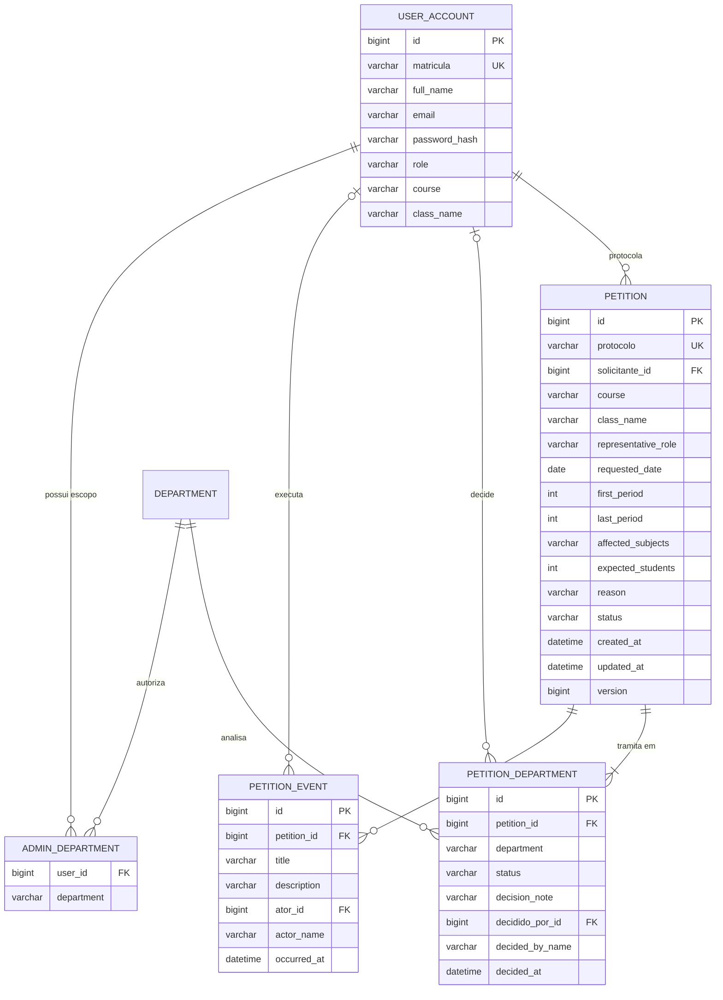
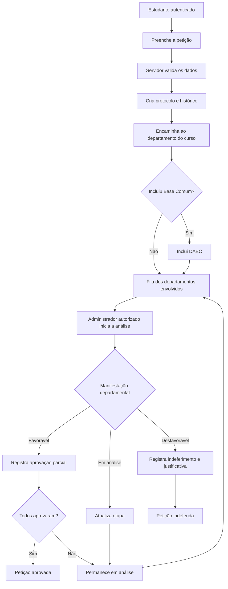

# Modelo de dados e fluxo institucional

## 1. Visão entidade-relacionamento

**Observação:** `Course`, `Department`, `Role`, `PetitionStatus`, `DepartmentStatus` e `RepresentativeRole` são enums persistidos como texto, não entidades com tabelas próprias. `ADMIN_DEPARTMENT` é a tabela de coleção gerada pelo `@ElementCollection` de `UserAccount`.

## 2. Justificativa das cardinalidades

- Um estudante pode protocolar várias petições; cada petição possui exatamente um solicitante.
- Uma petição pode exigir manifestações de um ou mais departamentos. A associação `PETITION_DEPARTMENT` contém os dados específicos da etapa departamental e a referência ao administrador responsável.
- Uma petição pode acumular eventos de auditoria, preservando quem realizou cada ação e quando.
- Um administrador pode responder por um ou vários departamentos. A coleção de escopo não concede autoridade para áreas não associadas à conta.
- O protocolo pertence à petição, não à manifestação departamental. Assim, uma solicitação multiárea permanece um único processo rastreável.

## 3. Encaminhamento

| Curso técnico informado na conta | Departamento principal |
|---|---|
| Técnico em Informática | DCOM |
| Técnico em Edificações | DINFRA |
| Técnico em Agrimensura | DINFRA |
| Técnico em Eventos | DGH |
| Técnico em Secretariado | DGH |
| Técnico em Eletrônica | DEEA |
| Técnico em Eletrotécnica | DEEA |

DABC é uma área transversal. O formulário permite incluí-lo quando a solicitação também afeta aulas da Base Comum. A decisão não depende de o aluno escrever livremente o código do departamento: o principal é calculado pelo curso e o DABC é selecionado em um campo próprio.

## 4. Ciclo de vida

O estado geral é consolidado no backend. Um indeferimento encerra o processo e bloqueia novas manifestações, preservando as etapas ainda pendentes apenas como histórico de tramitação. A interface não é fonte de autoridade. Um estudante não possui endpoint, botão ou permissão para aprovar/indeferir. O `SecurityFilterChain` restringe `/admin/**` a `ROLE_ADMIN`, e o `PetitionService` confirma novamente se o administrador tem o departamento atribuído.

## 5. Matriz de permissões

| Ação | Estudante | Administrador |
|---|---:|---:|
| Criar conta de estudante | Sim | Não pelo cadastro público |
| Protocolar petição | Sim | Não |
| Consultar petição própria | Sim | Não, salvo seu escopo departamental |
| Editar/cancelar petição pendente própria | Sim | Não |
| Iniciar análise departamental | Não | Sim, dentro do escopo |
| Aprovar/indeferir etapa departamental | Não | Sim, dentro do escopo |
| Consultar petições de outra área | Não | Não, exceto se também tiver essa atribuição |

## 6. Limites intencionais do protótipo

- O cadastro local recebe matrícula digitada pelo usuário; não valida o vínculo no SUAP.
- Curso e turma são declarados no cadastro e dependem de conferência institucional na implantação.
- A grade do EduPage é aberta para consulta externa; não há sincronização automática ou API presumida.
- O registro da decisão fica no sistema acadêmico do projeto. Ele não substitui portaria, autorização formal ou procedimento oficial do IFMT.
